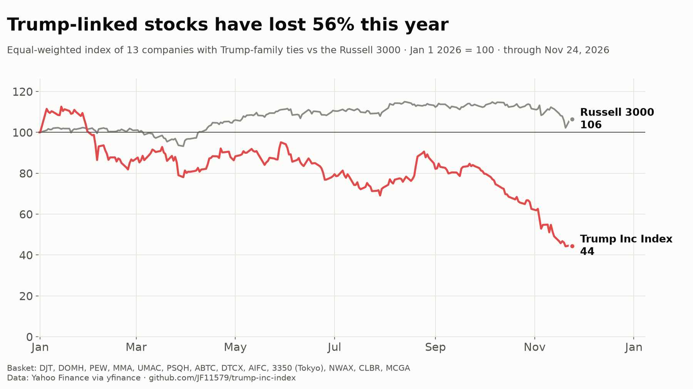
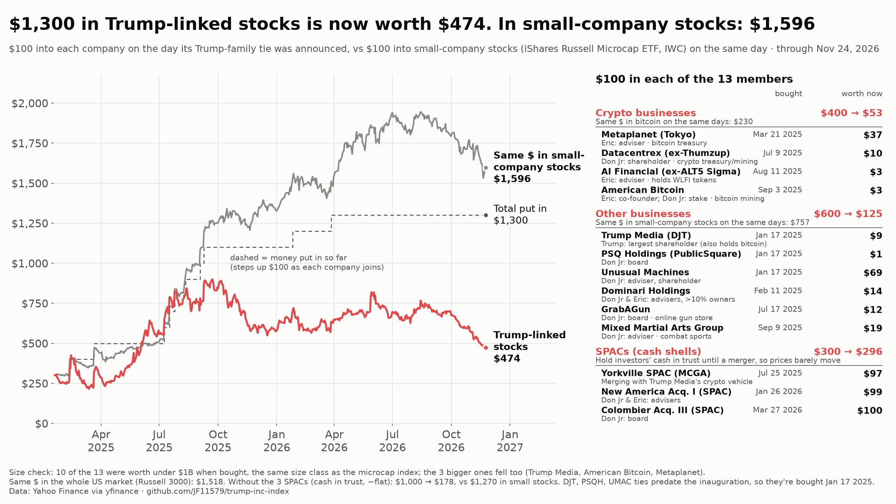

# Trump Inc Index

An equal-weighted index of publicly traded companies with ties to Donald Trump and his family, tracked against the whole US stock market (Russell 3000).

Inspired by *The Economist*'s ["Trump Inc is in free fall"](https://www.economist.com/business/2026/11/16/trump-inc-is-in-free-fall) (Nov 16, 2026). That article built a basket of 13 Trump-linked stocks but didn't publish the list, so this repo rebuilds it from public reporting, using public price data.

> **This is not a real fund, and none of this is investment advice.** "Index" here just means an average of price changes.



## The basket

| Ticker | Company | Family tie |
|---|---|---|
| DJT | Trump Media & Technology Group | Donald Trump is the largest shareholder |
| DOMH | Dominari Holdings | Don Jr & Eric: advisory board, together own >10% |
| PEW | GrabAGun | Don Jr: board of directors |
| MMA | Mixed Martial Arts Group | Don Jr: strategic adviser |
| UMAC | Unusual Machines | Don Jr: advisory board + shareholder |
| PSQH | PSQ Holdings (PublicSquare) | Don Jr: board of directors |
| ABTC | American Bitcoin | Co-founded by Eric; Don Jr holds a stake |
| DTCX | Datacentrex (formerly Thumzup) | Don Jr: shareholder |
| AIFC | AI Financial (formerly ALT5 Sigma) | Eric: adviser/board observer; holds World Liberty tokens |
| 3350.T | Metaplanet (Tokyo) | Eric: strategic board adviser |
| NWAX | New America Acquisition I (SPAC) | Don Jr & Eric: advisory board |
| CLBR | Colombier Acquisition III (SPAC) | Don Jr: board |
| MCGA | Yorkville Acquisition (SPAC) | Merging with Trump Media Group CRO Strategy |

The $TRUMP meme coin and the World Liberty Financial (WLFI) token appear in the per-asset charts but are **not** in the index, which holds stocks only. See [`holdings.csv`](holdings.csv) for a source link for each family tie.

## Method

- **Base:** close on Dec 31, 2025 = 100.
- **Equal-weighted, rebalanced daily:** each day's index return is the average of that day's returns across the holdings. NWAX and CLBR listed during 2026 and join the index on their first trading day.
- **Benchmark:** iShares Russell 3000 ETF (IWV), the same benchmark The Economist used.
- **Data:** daily closes from Yahoo Finance via `yfinance`, adjusted for splits and dividends. Metaplanet (Tokyo) and the crypto prices are forward-filled onto US trading days.
- **Check against The Economist:** on Nov 16 this basket stood at about 47, versus about 42 in The Economist's chart. The 13 names won't match theirs exactly.

## Second term: $100 in each



`make_term_chart.py` asks a plain question: **if you'd put $100 into each Trump-linked company on the day its family tie was announced, what would it be worth now, compared with the same $100s put into small-company stocks on the same days?**

- **Purchase dates** come from the `joins_index` column in `holdings.csv`. DJT, PSQH and UMAC ties predate the inauguration, so those three are bought at the Jan 17, 2025 close, the last close before the Jan 20 inauguration. That keeps out price history from before a company was Trump-linked, such as GrabAGun's blank-SPAC period or American Bitcoin's predecessor company.
- **No rebalancing.** Each $100 just rides, so the result is simply the sum of 13 positions.
- **Matched benchmark.** Every $100 into a Trump stock is paired with $100 into the iShares Micro-Cap ETF (IWC, tracking the Russell Microcap) on the same day. Most members are microcaps, so this answers the objection that "tiny speculative stocks always crash." 10 of the 13 were worth under $1B when bought, and the 3 larger ones (Trump Media, American Bitcoin, Metaplanet) fell too.
- **The panel splits members into three groups.** Crypto businesses (American Bitcoin, Metaplanet, Datacentrex, AI Financial) are compared with the same $ in **bitcoin** on the same days, to answer "these are just crypto stocks." Other businesses are compared with small-company stocks. SPACs are shown separately because they hold cash. Trump Media is grouped with the other businesses (its core business is Truth Social), though it also holds bitcoin.
- **The chart's footer** also shows the same money in the whole US market (Russell 3000, IWV) and the result without the 3 SPACs.

An earlier version of this chart used a daily-rebalanced equal-weighted index. Rebalancing daily keeps adding money to the losers, so with stocks this volatile it shows a steeper loss (−79% vs −64%). The $100-in-each version is easier to explain and more conservative.

## Caveats

- **The SPACs (NWAX, CLBR, MCGA) hold cash in trust**, so they sit near $10 until a merger closes. They make the index look *less* bad: without them it's about 35, not 45.
- **"Ties" range from tight to loose:** a controlling stake in DJT versus an advisory role at Metaplanet. A tie doesn't imply wrongdoing.
- **Some companies renamed during 2026** (Thumzup → Datacentrex, ALT5 Sigma → AI Financial). Price history follows each ticker.

## Run it

```bash
python3 -m venv .venv && .venv/bin/pip install -r requirements.txt
.venv/bin/python fetch_prices.py   # -> data/prices.csv
.venv/bin/python make_charts.py    # -> data/index.csv, plots/1-3
.venv/bin/python make_term_chart.py # -> data/portfolio_term.csv, plots/4 (also reruns 1-3)
```

## Charts

- `plots/1_index_vs_market.png`: the index vs the Russell 3000
- `plots/2_ytd_by_holding.png`: year-to-date change for each holding
- `plots/3_small_multiples.png`: each asset's price path vs the market
- `plots/4_since_inauguration.png`: $100 in each company on the day its tie was announced vs the same $ in small-company stocks
